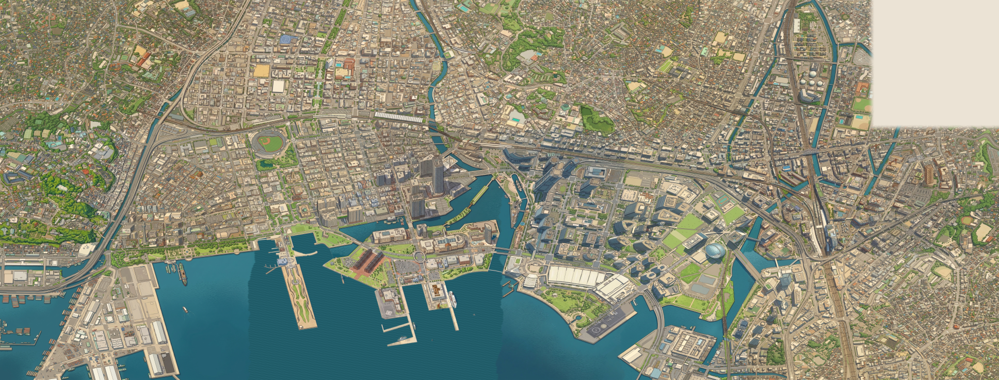

# Small Yokohama

[English](README.md) · **日本語**

横浜駅からみなとみらい、新港、山下公園を経て元町・中華街まで、横浜の臨海部をズームして歩き回れるミニチュア地図です。[Small SF](https://smallsf.com/)に着想を得て、イラストの街並みに動く乗り物、交通シミュレーション、リアルタイムの天気を重ねました。

**[地図を開く](https://small-yokohama.vercel.app/)**

## 横浜臨海部のパノラマ



*23枚のイラストをつないだ15,488 × 5,888 pxのパノラマです。[制作ガイド](docs/project-guide.ja.md)で、地区ごとの拡大画像や継ぎ目の検証結果を見られます。*

## 地図でできること

- **街区まで拡大する。** ドラッグで移動、ホイールやピンチで拡大縮小。地名は日英を切り替えられます。
- **乗り物を追いかける。** バス・電車・移動中の船を選ぶと追従します。電車は取得できる場合にライブ情報を使い、取れない場合は時刻表で補います。街路の車と歩行者はシミュレーションです。
- **時間と天気の変化を楽しむ。** 横浜の時刻と天気に合わせて光や雨が変わります。港の環境音をオンにしたり、見つけた場所をリンクで共有したりできます。

## ローカルで動かす

Windows PowerShellでリポジトリのルートから実行します。

```powershell
npm.cmd install
npm.cmd run dev
```

[http://127.0.0.1:5173](http://127.0.0.1:5173) を開きます。全体地図の生成や検証コマンドは[制作ガイド](docs/project-guide.ja.md)にまとめています。

## プロジェクト資料

| 内容 | リンク |
| --- | --- |
| 地区別の画像・制作手順・検証 | [制作ガイド](docs/project-guide.ja.md) |
| タイルの座標と対象範囲 | [タイル一覧](docs/tile-grid-plan.md) · [対象範囲（GeoJSON）](scope/waterfront.geojson) |
| 設計と技術構成 | [システム設計](docs/design.ja.md) · [技術スタック](docs/technology.ja.md) |
| データの出典・クレジット・ライセンス | [調査と出典](docs/research.ja.md) · [MITライセンス](LICENSE) |
