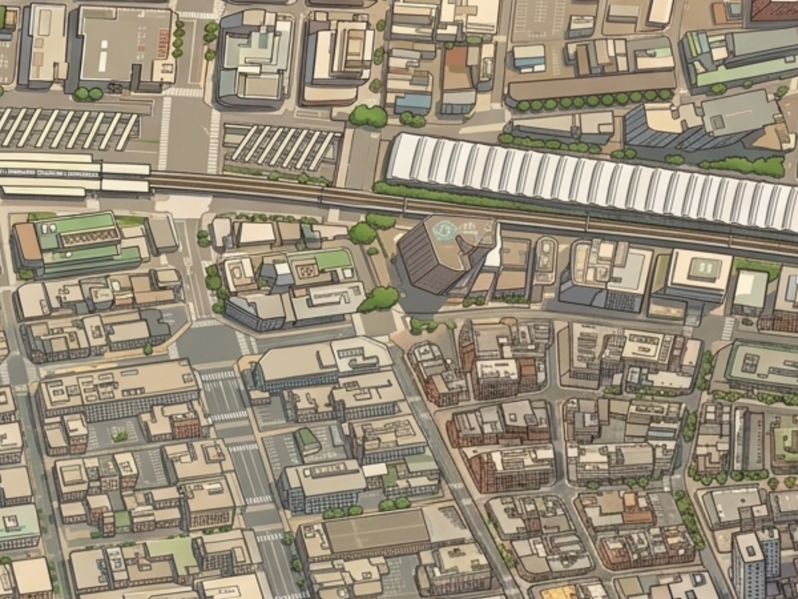
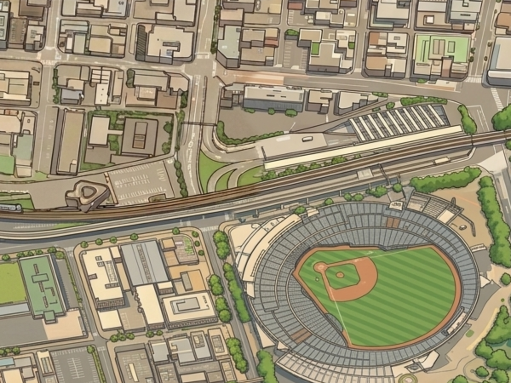
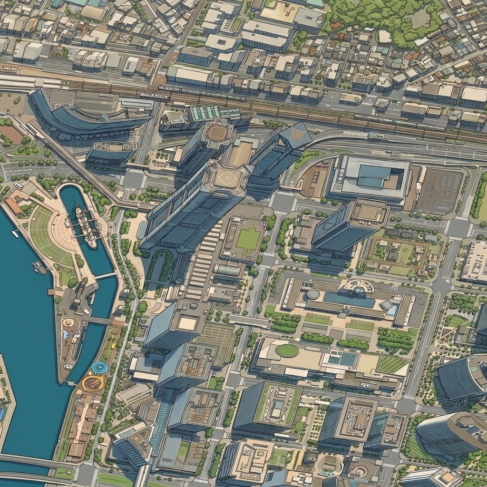
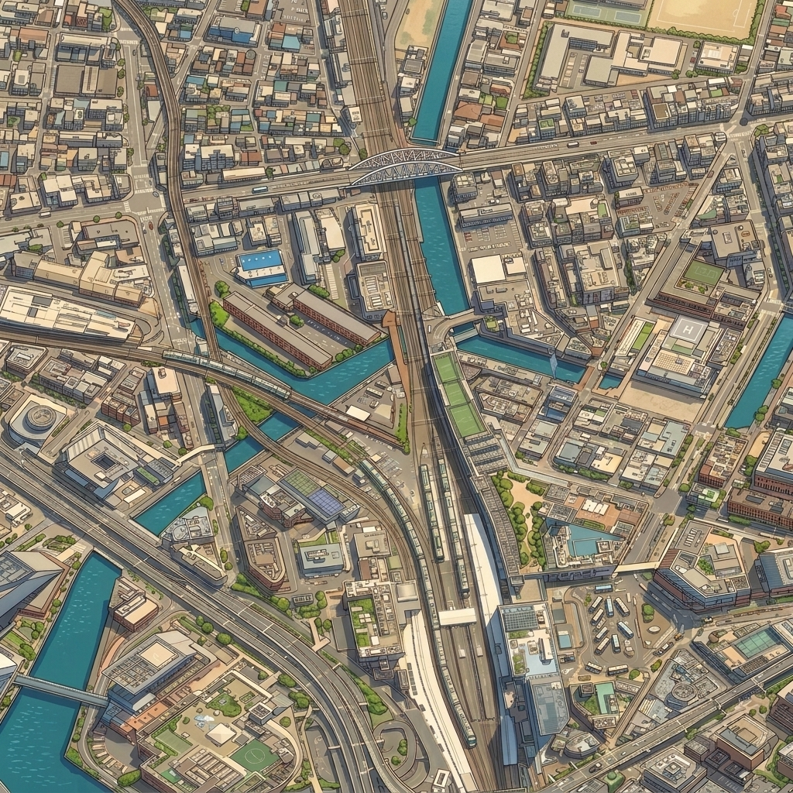
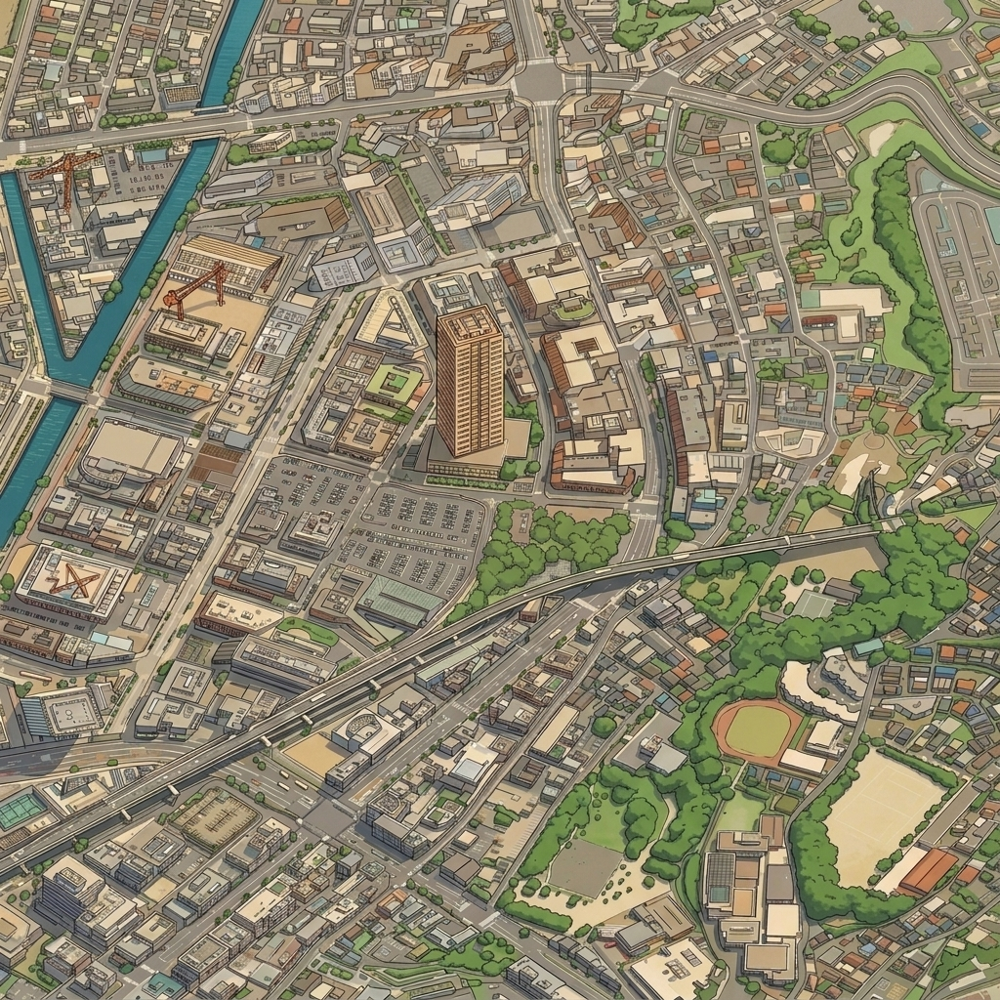
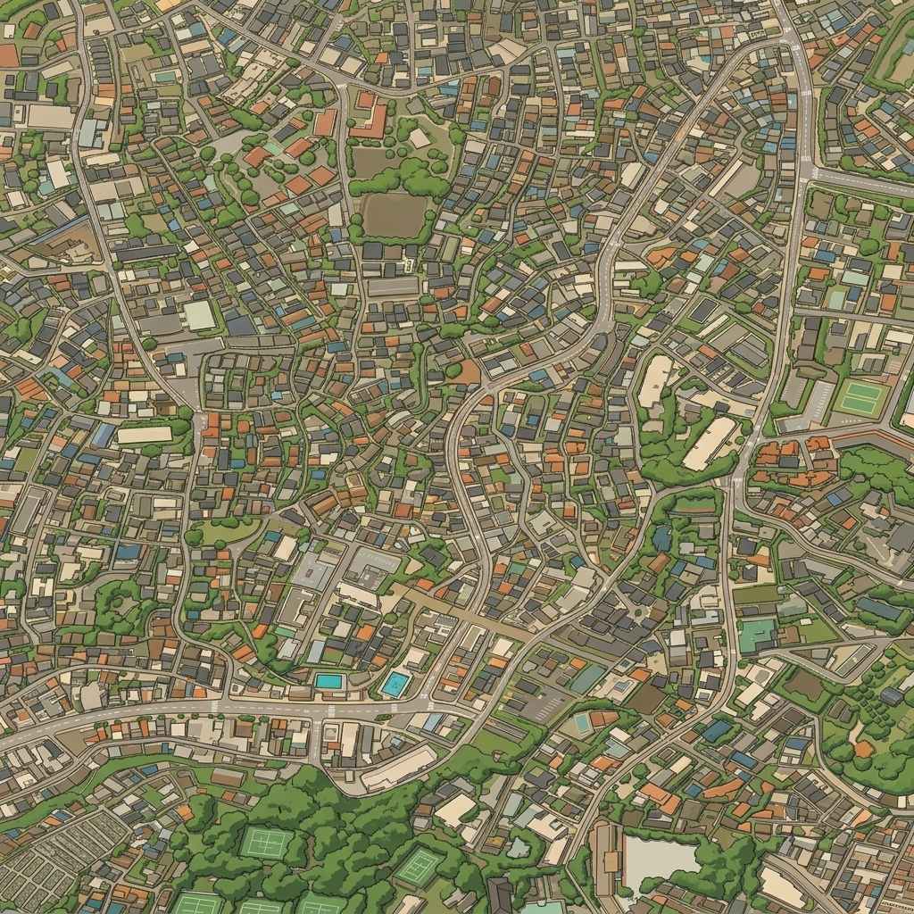
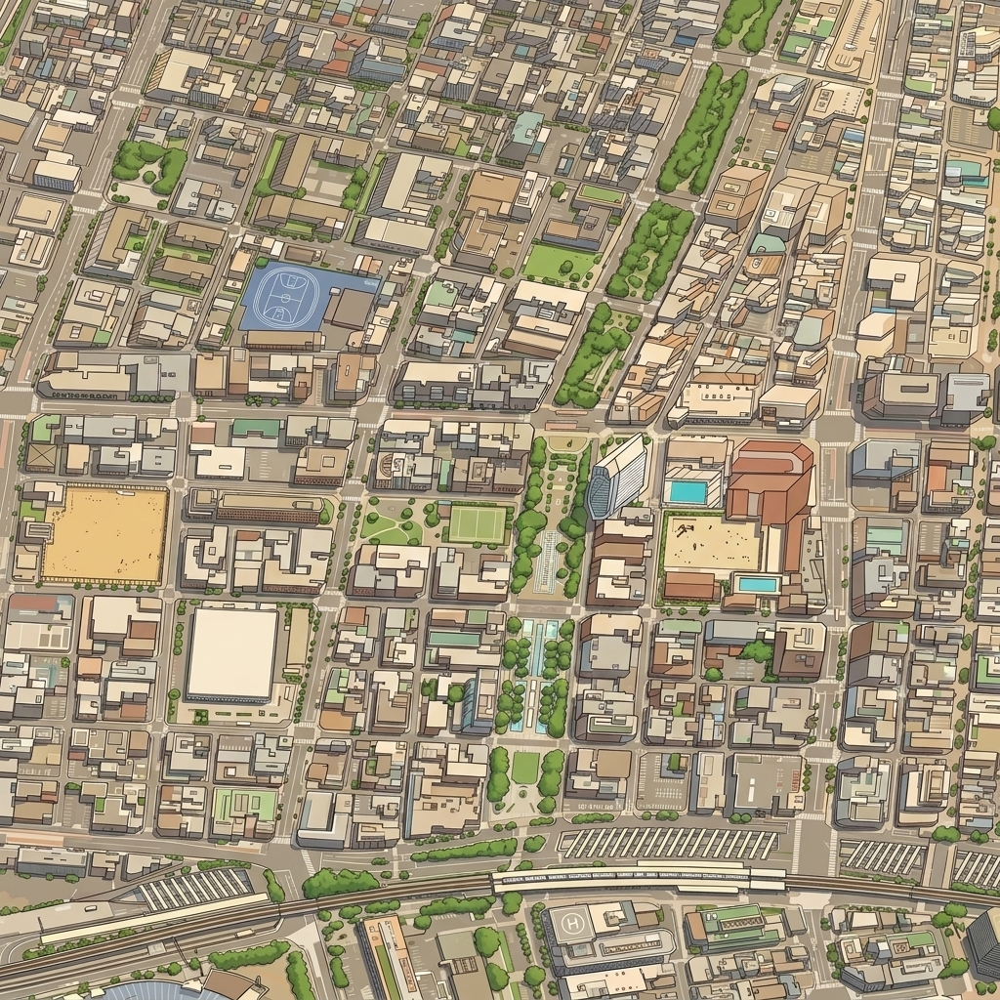
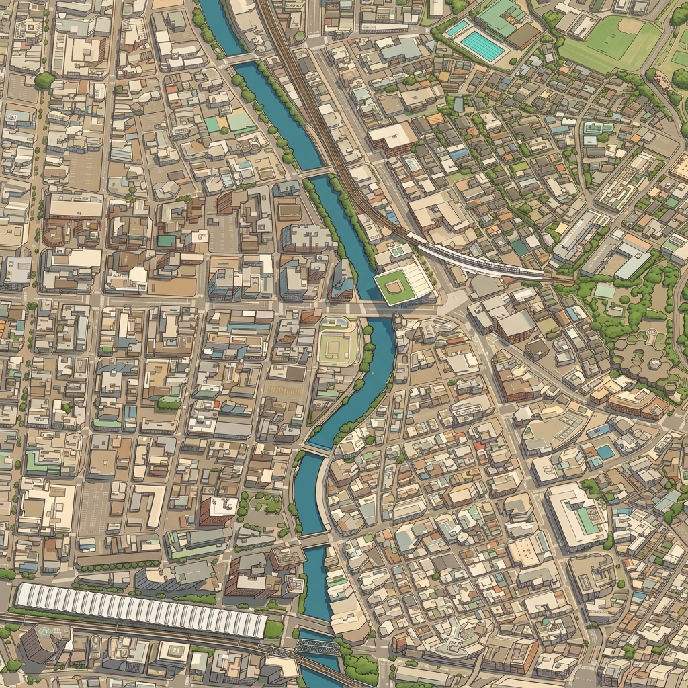
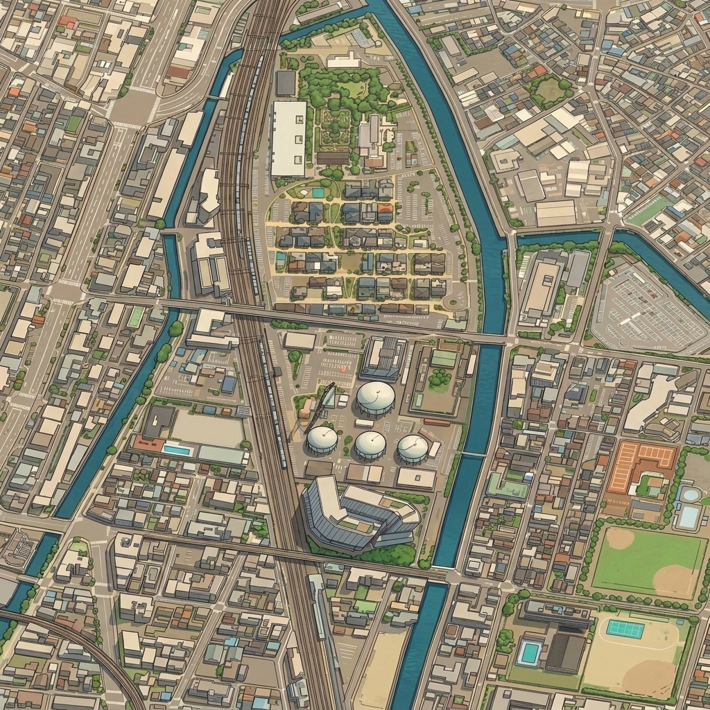

# スモール横浜

[English](README.md) · **日本語** · [全体タイル割当・座標表](docs/tile-grid-plan.md) · [地図で対象範囲を見る（GeoJSON）](scope/waterfront.geojson) · [全体設計](docs/design.ja.md) · [開発技術とデータ](docs/technology.ja.md) · [調査・出典](docs/research.ja.md)

> **横浜の臨海部を、拡大して眺められる動くミニチュア・イラスト地図に。** [Small SF](https://smallsf.com/) に着想を得ています。  
> **公開サイト: [small-yokohama.vercel.app](https://small-yokohama.vercel.app/)**  
> 横浜駅からみなとみらい・新港・赤レンガ倉庫を経て山下公園、元町・中華街までを、45°正射影のリーニュ・クレール調ミニチュア地図と交通・天候・時間帯連動オーバーレイで再現するオープンプロジェクトです。**全23タイル（先行パイロット4枚、フェーズA 12枚、フェーズB 7枚）を `15,488 × 5,888 px` のパノラマに連結し、Deep Zoom Image（DZI）ピラミッドと全体ビューアを `full-yokohama-v1` としてビルドしました。**

青い連節バスが倉庫の角を曲がって建物の陰に入り、地図を海沿いに動かすと山下公園が見えてくる。

---

## 現在の制作進捗（全23タイル完成）

> 全23タイルは動的計画法（DP）で色差が最小となる継ぎ目を求めて連結し、縦21本・横2本の境界検査がすべて合格しました。ビルドには `illustrated.dzi` と `plain.dzi`、`7,744 × 2,944` の深度・地物IDタイル、全体ビューアが含まれます。

- [x] **先行パイロット** (`pilot`: 4/4 完了) — ハンマーヘッド・大さん橋・赤レンガ倉庫・ワールドポーターズ・汽車道・横浜スタジアム・日本大通り
- [x] **担当 1** (`phase-a-1`: 4/4 完了 / `moruku36`) — 山下公園・氷川丸・横浜マリンタワー・横浜中華街・山下ふ頭・港の見える丘公園・元町
- [x] **担当 2** (`phase-a-2`: 4/4 完了 / `moruku36`) — 横浜ランドマークタワー・クイーンズスクエア・パシフィコ横浜・臨港パーク・新高島・日産本社・中央卸売市場
- [x] **担当 3** (`phase-a-3`: 4/4 完了 / `moruku36`) — 横浜駅東西・そごう・スカイビル・ベイクォーター・ポートサイド・鶴屋町・反町公園・西神奈川高台
- [x] **担当 4** (`phase-b-1`: 4/4 完了 / `moruku36`) — 山手南・元町南側内陸・石川町駅・中村川・関内駅・大通り公園・野毛・日ノ出町・大岡川
- [x] **担当 5** (`phase-b-2`: 3/3 完了 / `moruku36`) — 紅葉坂・掃部山・戸部駅・国道1号・石崎川・平沼橋・球形ガスホルダー・岡野公園

---

## 現在のビューア実装機能（`full-yokohama-v1`）

- **街路レベルの深ズームとスムーズな操作** — `15,488 × 5,888 px` の DZI（`0.34 m/px`）上で、PC のドラッグ移動・ホイール／トラックパッドズーム、モバイルの自然なピンチズーム、Small SF 相当の超近接街区ズーム（表示幅 約 60〜90 m）、さらに引いた状態での周縁部の積雲オーバーレイを実装しています。
- **実 OSM ルートに沿ったバス・横浜港客船・5路線の実線電車**:
  - **バス 22 台**（ベイサイドブルー連節バス・あかいくつ・ピアライン・市営バス 26/8/58 系統）が OpenStreetMap の実在道路ネットワーク上を走行します。
  - **横浜港の船舶 14 隻**（飛鳥II・ダイヤモンド・プリンセス・にっぽん丸・マリンルージュ・マリンシャトル・ロイヤルウイング・シーバス・タグボート等）が航跡つきで海域マスクに沿って航行します。
  - **鉄道 5 路線**（`JK` 京浜東北・根岸線、`JT` 東海道線、`JO` 横須賀・湘南新宿ライン、`KK` 京急本線〔野毛山トンネル地中非表示対応〕、`SO` 相鉄本線）が [`api/trains.js`](api/trains.js)（ODPT リアルタイム連携＋時刻表フォールバック）経由で走行し、クリックで路線カードを表示できます。
- **Small SF 式の街中交通シミュレーションと歩道限定（車道0人）の歩行者**:
  - **交差点分割された 832 本の有向道路エッジ**上で、信号サイクル（青・黄・全赤）・一時停止・車群追従・右左折減速・日本の左側複数車線・朝夕ラッシュや深夜帯の交通量変化を再現。最大 420 台の 3D 車両（9色の乗用車・横浜タクシー・白バン・トラック・センサー付き自動運転風セダン）を拡大時の黒インク輪郭線・ガウシアン前照灯・ブレーキ連動テールランプ付きで描画し、バスと電車には建物遮蔽時の半透明ゴースト表現を備えています。
  - **2,650 人のミニチュア歩行者**は、24 枚の深度タイル `surfaceKind` 判定と全市 OSM 道路・線路クリアランス検査を通過した歩道・広場・デッキのみに配置されています（車道・線路・建物内・海上の配置は `0` 人）。
- **リアルタイム JST 太陽光・街灯・リアルタイム天候（雨表現）**:
  - 実時間の日本標準時（JST）と太陽高度に応じた昼・夕焼け・薄暮・深い夜のライティング、**市内全域 1,600 か所の OSM 街灯**を表示します。
  - [`api/weather.js`](api/weather.js)（Open-Meteo 連携）による横浜の天気・気温表示、斜め降水の雨アニメーション、手動切替（自動 / 晴れ / 雨、`?weather=rain`）に対応しています。
- **日英バイリンガル地名・施設（ランドマーク 49 件・POI 440 件）** — 主要駅（横浜・桜木町・関内・石川町・みなとみらい・新高島ほか）、パシフィコ横浜、横浜市中央図書館・神奈川県立図書館、神奈川大学みなとみらいキャンパス、市内 23 社の本社ビル、横浜駅周辺（JR横浜タワー・ニュウマン横浜、髙島屋・相鉄ジョイナス、ルミネ、モアーズ、ビブレ等）を収録しています。
- **Small SF 流のオープニング・サウンド・ホバー・追従・共有リンク**:
  - 地図を開くと、積雲を抜けて街へ降りていく演出が入ります（昼・夕・夜で雲の色が変わります）。地図をつかむと途中で終わり、`?intro=0` または「視差効果を減らす」設定では省略されます。
  - スピーカーボタンで、Web Audio で合成した港の環境音（音声ファイルなし）が鳴ります。波音・街のざわめき・雨天時の雨音・船がいるときの汽笛・昼間のカモメです。
  - PC では、カーソルを乗せるとバスと行き先、電車と次の停車駅、船、ランドマーク、建物の名前を表示します。
  - バス・電車・航行中の船をクリックすると、カメラが追いかけます。地図をドラッグするか、カードの「追いかける」で解除できます。
  - 「共有」は Small SF と同じ形式の地理座標リンク `?at=緯度,経度,<表示幅>m`（例: `?at=35.44400,139.65050,900m`）をコピーし、既定値のままの設定は省きます。従来の `?x=&y=&z=` 形式のリンクも開けます。

---

## 横浜臨海部 全 23 タイル シームレス結合パノラマ（`15,488 × 5,888 px`）

国土地理院 `z=18` 空中写真＋OpenStreetMap 3D 地物を 45° 正射影カメラで固定レンダリングし、1枚ずつ Ligne-Claire インク＋暖色系ガッシュ画風へ清書した全 23 タイルを 128px 重複帯の DP 最小色差接続（14px フェザリング）で 1 枚に統合した成果物です。


### 全体シーム 1:1 拡大検証（4タイル交差点クロス確認 `1200 × 900 px`）

| 横浜駅・ベイクォーター・高島水際線 (`(3,0)-(4,1)`) | みなとみらい・ランドマーク・野毛山 (`(1,-1)-(2,0)`) |
| :---: | :---: |
|  |  |
| **関内・野毛・大岡川・馬車道 (`(0,-1)-(1,0)`)** | **横浜スタジアム・中華街・石川町 (`(-1,-1)-(0,0)`)** |
|  |  |

### 先行パイロット 4/4（128px 重複帯シームレス結合済み：`3968 × 3968 px`）


### 担当 1（`phase-a-1`：元町・山手・中華街・山下公園・氷川丸・山下ふ頭 4/4 完了）

| 左上 `tile_-2_0`（港の見える丘公園・山手・元町） | 右上 `tile_-1_0`（山下公園・マリンタワー・中華街） |
| :---: | :---: |
|  |  |
| **左下 `tile_-2_1`（山下ふ頭南・新山下運河・はしけ泊地）** | **右下 `tile_-1_1`（山下公園海側・氷川丸・山下ふ頭北）** |
|  |  |

### 担当 2（`phase-a-2`：みなとみらい・ランドマーク・パシフィコ・新高島・卸売市場 4/4 完了）

| 左上 `tile_2_0`（ランドマーク・クイーンズ・日本丸） | 右上 `tile_3_0`（新高島・日産本社・メディアタワー） |
| :---: | :---: |
|  |  |
| **左下 `tile_2_1`（パシフィコ・インターコンチ・臨港パーク）** | **右下 `tile_3_1`（高島水際線・みなとみらい大橋・中央卸売市場）** |
|  |  |

### 担当 3（`phase-a-3`：横浜駅東西・そごう・ベイクォーター・ポートサイド・鶴屋町・反町・西神奈川高台 4/4 完了）

| 左上 `tile_4_0`（横浜駅東西・そごう・スカイビル・JR横浜タワー） | 右上 `tile_5_0`（鶴屋町・新田間川・首都高三ツ沢線・反町公園） |
| :---: | :---: |
|  |  |
| **左下 `tile_4_1`（横浜ベイクォーター・ポートサイド・首都高横羽線）** | **右下 `tile_5_1`（西神奈川・反町北・栗田谷・斎藤分町高台）** |
|  |  |

### 担当 4（`phase-b-1`：山手・石川町・関内・大通り公園・野毛・大岡川 4/4 完了）

| 左上 `tile_-2_-1`（山手・元町南側内陸・山手公園） | 右上 `tile_-1_-1`（石川町駅・中村川・イタリア山庭園） |
| :---: | :---: |
|  |  |
| **左下 `tile_0_-1`（関内駅・大通り公園・横浜BUNTAI）** | **右下 `tile_1_-1`（野毛・日ノ出町・大岡川・都橋商店街）** |
|  |  |

### 担当 5（`phase-b-2`：紅葉坂・掃部山・戸部・平沼橋・岡野公園 3/3 完了）

| 左 `tile_2_-1`（紅葉坂・掃部山・野毛山・県立音楽堂） | 中央 `tile_3_-1`（戸部駅・国道1号・石崎川・西区中央） | 右 `tile_4_-1`（平沼橋・ガスホルダー・イングリッシュガーデン・岡野公園） |
| :---: | :---: | :---: |
|  |  |  |

### ズーム拡大・境界シーム確認

| マスター画風基準 (#1: `tile_1_1`) | 境界シーム確認（サークルウォーク〜ワールドポーターズ） |
| :---: | :---: |
|  |  |
| **横浜スタジアム（`tile_0_0` 拡大）** | **汽車道・運河（`tile_1_0` 拡大）** |
|  |  |

- **パイロット実測 QA 結果（`viewer/public/releases/pilot-shinko-v1/qa-report.json`）**:
  - 位置合わせ相関: 全 4 タイル **`shift=(0,0) px`**、Sobel エッジ相関 **`edgeCorr = 0.770 〜 0.858`**
  - 8 地点 GCP 最大誤差: **`0.601 px`**（許容 `<= 8 px`）
  - 境界シーム色差（14px DP 最小色差接続）: `6.32` / `9.83` / `23.07`（許容 `< 48`、**全境界合格**）
  - 水域捏造ゼロ確認: `waterInventedBuildings = 0` / `voidPixels = 0`

---

## 制作で気をつけているこだわり（品質方針）

[Small SF Author's making-of](https://smallsf.com/about) の設計思想を取り入れ、見た目の可愛らしさと地図・データとしての正確さを両立するため、以下を徹底しています。

1. **45° 正射影 × 奥行き（Depth）による自然な隠れ表現**  
   すべてのタイルを同一カメラ（`azimuth = 225°`, `depression = 45°`, `0.34 m/px`）で固定し、奥行き・路面標高マップを同時生成しています。これにより、動くバスや船がサークルウォーク・建物・橋の裏に差し掛かると車体の一部だけが自然に隠れます。
2. **国土地理院 `z=18` 空中写真＋OSM 3D による「完全ピクセル固定」**  
   想像で街並みを描かず、航空写真と 3D 地物を隙間なく投影した `_base.png` を下絵にロックします（1px の回転・拡大・トリミングも禁止）。
3. **画風ドリフトを防ぐ「マスター1枚固定ルール」**  
   隣り合うタイル同士を数珠つなぎで参照すると少しずつ色味や線幅がズレます。**全タイル必ず `data/drawn-tiles/tile_1_1.png`（#1）1 枚のみを画風リファレンスに固定** してください。
4. **水面と船舶・陸地の厳密な分離**  
   海面だけでなく運河・川（汽車道まわり・新港橋・大岡川・中村川等）もすべて **深いティールブルー（`#226276`）** に統一します。合成時は 3D 水域マスクと 22px 船舶保護ハローを使い、船が陸地に乗り上げたり海上に架空の建物が現れたりするのを防いでいます。
5. **128px オーバーラップ＋自動 QA ゲート**  
   タイル間は 128px 重ねて生成し、DP 最小色差カットで継ぎ目を消しています。納品時は必ず `render:tile` の Sobel 相関で **`|shift| <= 8 px`**・**`edgeCorr >= 0.70`** を確認します。

---

## 全体タイル数とチーム割り振り計画

[scope/waterfront.geojson](scope/waterfront.geojson) の横浜臨海部全体（横浜駅〜みなとみらい〜新港〜山下公園〜元町・中華街）をパイロット同一仕様（`2048 × 2048 px` / 歩進幅 `stride = 1920 px = 652.8 m` / 重複 `128 px`）で割ると、以下の通りになります。

- **全体格子サイズ**: **3 行 × 8 列 = 24 タイル**（`row = -1..1`, `col = -2..5` / 合成時 `15,488 × 5,888 px`）
- **スコープ対象タイル**: **全 23 タイル**（北西端の `(5, -1)` のみポリゴン範囲外）
- **完了済み**: **23 / 23 タイル全完了（100%）**（先行パイロット #1〜#4 ＋ フェーズ A 12 枚 ＋ 担当 4 `phase-b-1` 4 枚 ＋ 担当 5 `phase-b-2` 3 枚）
- **残り制作タイルは0枚。** 全体パノラマのビルドも完了しました。
  - **フェーズ A（臨海・主要駅コア `row = 0..1`）**: 全 12 タイル **12/12 完了・残り 0 タイル**
  - **フェーズ B（内陸縁辺ベルト `row = -1`）**: 全 7 タイル **7/7 完了・残り 0 タイル**

```text
row \ col   -2    -1     0     1     2     3     4     5
   -1      [B1]  [B2]  [B3]  [B4]  [B5]  [B6]  [B7]    .
    0      [A1]  [A2]  [P4]  [P3]  [A5]  [A7]  [A9] [A11]
    1      [A3]  [A4]  [P2]  [P1]  [A6]  [A8] [A10] [A12]
```

| フェーズ | 担当 | ブロック名 (`--block`) | 割り当てタイル | 主なエリア |
| --- | --- | --- | --- | --- |
| 完了 | 先行パイロット | `pilot` | `(1,1), (0,1), (1,0), (0,0)`（**4/4 完了**） | ハンマーヘッド・大さん橋・赤レンガ・ワールドポーターズ・汽車道・横浜スタジアム・日本大通り |
| 完了（**A**） | **担当 1（moruku36）** | `phase-a-1` | `(-2,0), (-1,0), (-2,1), (-1,1)`（**4/4 完了**） | 山下公園・氷川丸・マリンタワー・中華街・山下ふ頭・元町 |
| 完了（**A**） | **担当 2（moruku36）** | `phase-a-2` | `(2,0), (2,1), (3,0), (3,1)`（**4/4 完了**） | ランドマークタワー・クイーンズスクエア・パシフィコ・臨港パーク・新高島・Kアリーナ |
| 完了（**A**） | **担当 3（moruku36）** | `phase-a-3` | `(4,0), (4,1), (5,0), (5,1)`（**4/4 完了**） | 横浜駅東西・そごう・ベイクォーター・鶴屋町・反町・西神奈川高台 |
| 完了（**B**） | **担当 4（moruku36）** | `phase-b-1` | `(-2,-1), (-1,-1), (0,-1), (1,-1)`（**4/4 完了**） | 山手南・石川町駅・関内駅・大通り公園・野毛・日ノ出町・大岡川 |
| 完了（**B**） | **担当 5（moruku36）** | `phase-b-2` | `(2,-1), (3,-1), (4,-1)`（**3/3 完了**） | 紅葉坂・掃部山・戸部駅・平沼橋・ガスホルダー・岡野公園 |

全 23 タイルの中心緯度経度・ランドマーク対応表は [docs/tile-grid-plan.md](docs/tile-grid-plan.md) に記載しています。

---

## チームメンバー向け：担当タイルの作り方（手順・モデル設定・プロンプト例）

### ステップ 1：環境セットアップと担当ブロック用ブランチ作成

```powershell
# 例: 担当5（紅葉坂・戸部駅・平沼橋）の場合
git checkout -b tile/phase-b-2-tobe-hiranumabashi
npm.cmd install   # macOS/Linux は npm install
```

### ステップ 2：自分の担当タイルの下絵（`_base.png`）を自動生成する

どの列範囲（`col = -2..5, row = -1..1`）でも使える汎用ベースレンダラー `render:tile` を用意しています。担当ブロック名または任意の `<col>,<row>` を指定すると、国土地理院 `z=18` 空中写真の取得から `2048×2048 px` 正射影ベース画像の出力まで自動実行されます。

```powershell
# 担当ブロックを一括生成する例（Windows PowerShell）
npm.cmd run render:tile -- --block phase-b-2

# 1タイルだけ生成する例
npm.cmd run render:tile -- --tile 2,-1
```

出力先: `data/tile-renders/tile_{col}_{row}_base.png`（例: `tile_2_-1_base.png`）

### ステップ 3：推奨する AI エージェント / モデル設定

先行 4 タイルは、以下の組み合わせ・方針で制作することで高い位置精度と画風一貫性（全 4 タイル `shift=(0,0) px`、`edgeCorr = 0.770〜0.858`）を達成できました。

- **オーケストレーター／指示役には上位の推論モデルを選ぶ（重要）**:  
  先行 4 タイルは **`gemini-pro-orchestrator-neon` クラスのハイエンド上位モデル** で全体計画・手順管理・ベース生成・画像生成指示・Sobel 位置検証・目視チェックまでを一貫制御し、作画担当に **`image-generator` サブエージェント** を使って実現しました。軽量モデル任せにすると、角度が勝手に変わる・運河が航空写真の茶色のまま残る・周辺建物が簡略化されすぎる傾向があるため、**上位のオーケストレーター／推論モデルを選定する**のがおすすめです。
- **参照の渡し方（必須の 2 点セット）**:
  1. **参考思想**: [Small SF](https://smallsf.com/) / [Author's making-of](https://smallsf.com/about) に近い 45° ミニチュア建築イラスト調で作ること
  2. **2 枚の参照画像を同時指定**:
     - **画像 1（形状・位置 100% 固定ベース）**: `data/tile-renders/tile_{col}_{row}_base.png`
     - **画像 2（画風・配色専用マスター）**: `data/drawn-tiles/tile_1_1.png`（※毎回必ず `#1` を参照）

### ステップ 4：そのまま使えるプロンプト例（コピペ用）

#### 例 A：AI コーディングエージェント（Antigravity 等）に担当ブロック制作を頼む場合

```text
あなたは Small Yokohama のタイル制作担当です。
参考サイト https://smallsf.com/ と https://smallsf.com/about に近いミニチュア建築イラスト調で、
担当タイル `tile_{col}_{row}`（例: `tile_2_-1` 紅葉坂・掃部山・戸部南寄り周辺）を作成してください。

手順：
1. 下絵がなければ `npm.cmd run render:tile -- --tile {col},{row}` を実行し、
   `data/tile-renders/tile_{col}_{row}_base.png` を生成して中身を目視確認してください。
2. `image-generator` サブエージェント（または画像生成モデル）へ以下の2画像を渡して作画してください：
   - 参照画像1（レイアウト・建物位置を1pxも変えない固定下絵）: `data/tile-renders/tile_{col}_{row}_base.png`
   - 参照画像2（画風・線幅・配色・水面色だけのマスター基準。※構図はコピーしない）: `data/drawn-tiles/tile_1_1.png`
3. 生成画像を `data/drawn-tiles/tile_{col}_{row}.png`（RGB PNG）として保存し、
   既存メタ（例: `data/drawn-tiles/tile_1_0_meta.json`）に倣って `data/drawn-tiles/tile_{col}_{row}_meta.json` を作成してください。
4. 再度 `npm.cmd run render:tile -- --tile {col},{row}` を実行して Sobel 相関チェックを行い、
   `|shiftDx|, |shiftDy| <= 8 px` かつ `edgeCorr >= 0.70` であること、および出力される
   `data/drawn-tiles/tile_{col}_{row}_overlay_check.png` に二重ズレや海上の架空建物・茶色い運河が残っていないことを目視で確認してください。
```

#### 例 B：画像生成モデル（`image-generator` 等）へ直接渡す指示プロンプト

```text
Small Yokohama 用に、1024x1024 の建築イラスト地図タイルを作成してください。
Small SF（smallsf.com）のリーニュ・クレールのインク線と、陽光を感じる暖色系ガッシュのミニチュア画風に合わせてください。
参照画像1（`tile_{col}_{row}_base.png`）の配置に厳密に合わせ、画風は参照画像2（`tile_1_1.png`）にそろえてください。

必須ルール
1. 参照画像1の形状と配置をピクセル単位で維持する。
   - 建物、塔、橋、道路、横断歩道、公園、線路、海岸線をすべて元の位置に保つ。
   - カメラの回転、ズーム、切り抜き、傾きの変更を加えず、枠や余白も設けない。
   - 端まで使った正方形（1:1）とし、文字、地名ラベル、数字、透かしを入れない。
2. 参照画像2（`tile_1_1.png`）は画風の基準にのみ使い、構図は写さない。
   - 屋根の縁、ファサードの格子、橋、護岸を、参照画像2と同じ濃いチャコールブラウン（`#2a2420`）の明瞭なインク線で描く。
   - 暖かな午後の日差しを感じるガッシュの配色、ふんわりした緑の木々、左下（西北西）へ伸びる輪郭の明瞭な淡いスレートブルーの影を再現する。
3. 水面と空中写真の細部を描き分ける。
   - 湾、運河、川、船着き場の水面を、参照画像2の深いティールブルー（`#226276`）で描き、細かな波紋を加える。
     空中写真の茶褐色やオリーブ色の水面を残さない。
   - 参照画像1の空中写真に写るすべての建物の輪郭を、45度のアイソメトリックな縮尺に合わせて立体的に描く。
     窓の桟や屋上の空調設備もリーニュ・クレールの線で描き込む。
```

### ステップ 5：セルフ検証して Pull Request を出す

1. 作成したタイルを `data/drawn-tiles/tile_{col}_{row}.png` と `data/drawn-tiles/tile_{col}_{row}_meta.json` に保存（※`_composited.png`・`_overlay_check.png`・`data/gsi-aerial/`・`data/tile-renders/` は `.gitignore` 済みなのでコミットされません）。
2. 以下を実行して全チェック通過を確認：
   ```powershell
   npm.cmd run render:tile -- --tile <col>,<row>
   npm.cmd run typecheck
   npm.cmd run test
   npm.cmd run build
   ```
3. コンフリクト防止のため、**1 担当ブロック（または 1 タイル）= 1 ブランチ / 1 PR** で GitHub へ提出してください。

---

## ローカルビューア起動・全体地図ビルド

```powershell
# 全23タイル横浜パノラマ（15488x5888 DZI + 半解像データタイル + QA + プレビュー）をビルド
npm.cmd run build:full

# OSMベースのバス・船舶・鉄道5路線・交通エッジ832本・街灯1600か所・歩道歩行者2650人を再生成
node tools/generate-yokohama-fleet.mjs

# 日英ランドマーク・POI（49ランドマーク / 440 POI）を再生成
node tools/enrich-yokohama-landmarks.mjs

# 全4タイル先行パイロット（pilot-shinko-v1）の再ビルド
npm.cmd run build:pilot

# 開発サーバー起動（http://127.0.0.1:5173）
npm.cmd run dev

# Vercelデプロイ用バンドル作成（deploy-vercel/）
npm.cmd run build:vercel
```

---

## クレジットとライセンス

- **着想** — Ari Dutilhさんの [Small SF](https://smallsf.com/) と [制作記](https://smallsf.com/about)
- **地理データ・空中写真・気象・交通API** — [OpenStreetMap（ODbL）](https://www.openstreetmap.org/copyright) · [国土地理院（地理院タイルのシームレス空中写真、z=18）](https://maps.gsi.go.jp/development/ichiran.html) · [Project PLATEAU 横浜市 2024年度](https://www.geospatial.jp/ckan/dataset/plateau-14100-yokohama-shi-2024) · [Open-Meteo](https://open-meteo.com/) · [公共交通オープンデータ協議会（ODPT）](https://www.odpt.org/)
- **リポジトリのコードとドキュメント** — [MITライセンス](LICENSE)。外部データと第三者素材には各配布元の条件が適用されます。[出典と表示条件](docs/research.ja.md)
