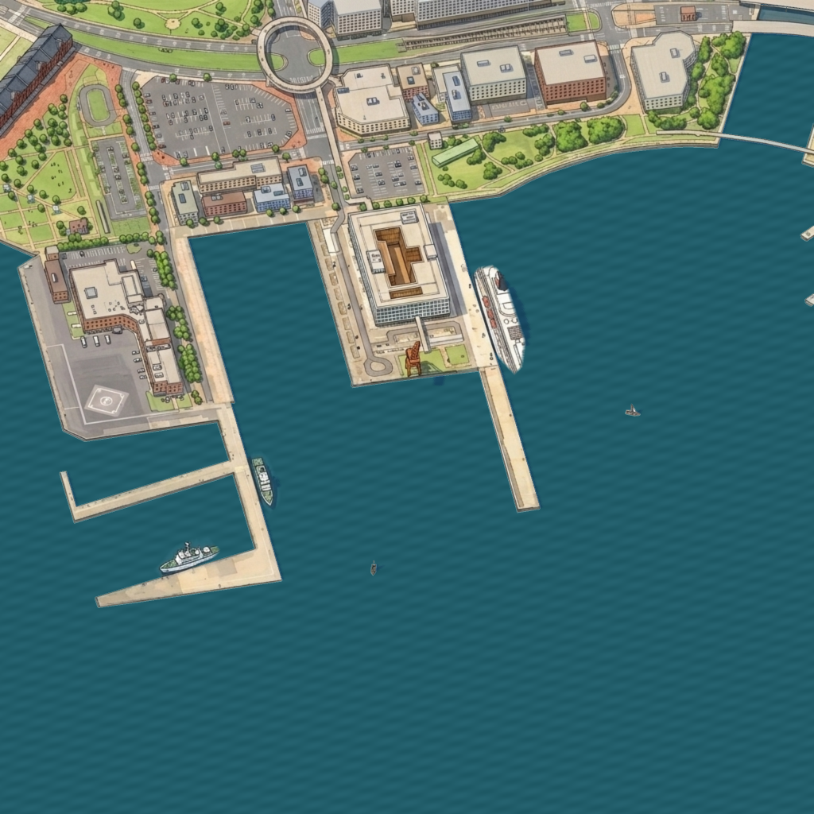

# スモール横浜 · Small Yokohama

[README (メインページ / 日本語＆English概要)](README.md) · [全体タイル割当・座標表](docs/tile-grid-plan.md) · [地図で対象範囲を見る](scope/waterfront.geojson) · [全体設計](docs/design.ja.md) · [開発技術とデータ](docs/technology.ja.md) · [調査・出典](docs/research.ja.md)

青い連節バスが倉庫の角を曲がって建物の陰に入り、地図を海沿いに動かすと山下公園が見えてくる。**スモール横浜**は、横浜駅からみなとみらいを経て元町・中華街までを、拡大して眺められる一枚の動くミニチュア・イラスト地図にするプロジェクトです。

現在、**新港パイロット 4 タイル ＋ フェーズ A 12 タイル ＋ 担当 4（`phase-b-1`）4 タイル ＋ 担当 5（`phase-b-2`）3 タイルの計 23/23 タイル（100%・全タイルコンプリート！）が完成**しました。このあと全 23 タイルの全体 1 枚連結・DZI ピラミッドビルドおよび全体ビューア反映へ進むことができます。

- [x] **先行パイロット (`pilot`)**: 4/4 完了
- [x] **担当 1 (`phase-a-1` / `moruku36`)**: 4/4 完了（山下公園・氷川丸・マリンタワー・中華街・山下ふ頭・元町）
- [x] **担当 2 (`phase-a-2` / `moruku36`)**: 4/4 完了（ランドマーク・クイーンズ・パシフィコ・臨港パーク・新高島・中央卸売市場）
- [x] **担当 3 (`phase-a-3` / `moruku36`)**: 4/4 完了（横浜駅東西・そごう・ベイクォーター・ポートサイド・鶴屋町・西神奈川高台）
- [x] **担当 4 (`phase-b-1` / `moruku36`)**: 4/4 完了（山手南・石川町・中村川・関内・大通り公園・野毛・大岡川）
- [x] **担当 5 (`phase-b-2` / `moruku36`)**: 3/3 完了（紅葉坂・掃部山・戸部・石崎川・平沼橋・ガスホルダー・帷子川）

---

## 新港パイロット 4/4 完成プレビュー（他 19 タイルのプレビューは [README.md](README.md) を参照）


| マスター基準 (#1: `tile_1_1`) | サークルウォーク境界シーム (`10_7`) | 横浜スタジアム (`1_1`) | 汽車道・運河 (`12_5`) |
| :---: | :---: | :---: | :---: |
|  |  |  |  |

---

## タイル構成・担当割り振り・作成ガイド

全体 23 タイルの配置図・担当 1〜5 の分担表・コピペ用プロンプト・上位モデル（オーケストレーター）設定のポイント・セルフ検証手順は、[README.md](README.md) および [docs/tile-grid-plan.md](docs/tile-grid-plan.md) に詳しくまとめています。

```powershell
# 任意のタイルまたは未着手ブロックの下絵（_base.png）を自動生成する
npm.cmd run render:tile -- --tile 2,-1
npm.cmd run render:tile -- --block phase-b-2

# パイロット全体ビルド・検証・ビューア起動
npm.cmd run build:pilot
npm.cmd run typecheck
npm.cmd run test
npm.cmd run dev
```

本リポジトリのオリジナル成果物には[MITライセンス](LICENSE)を適用します。外部データと第三者素材（OpenStreetMap ODbL、国土地理院タイル、PLATEAU 等）には各配布元の条件が適用されます。[出典と表示条件](docs/research.ja.md)
