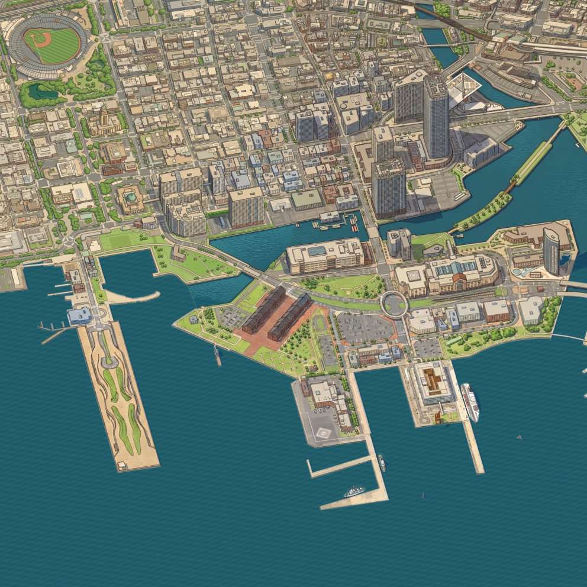
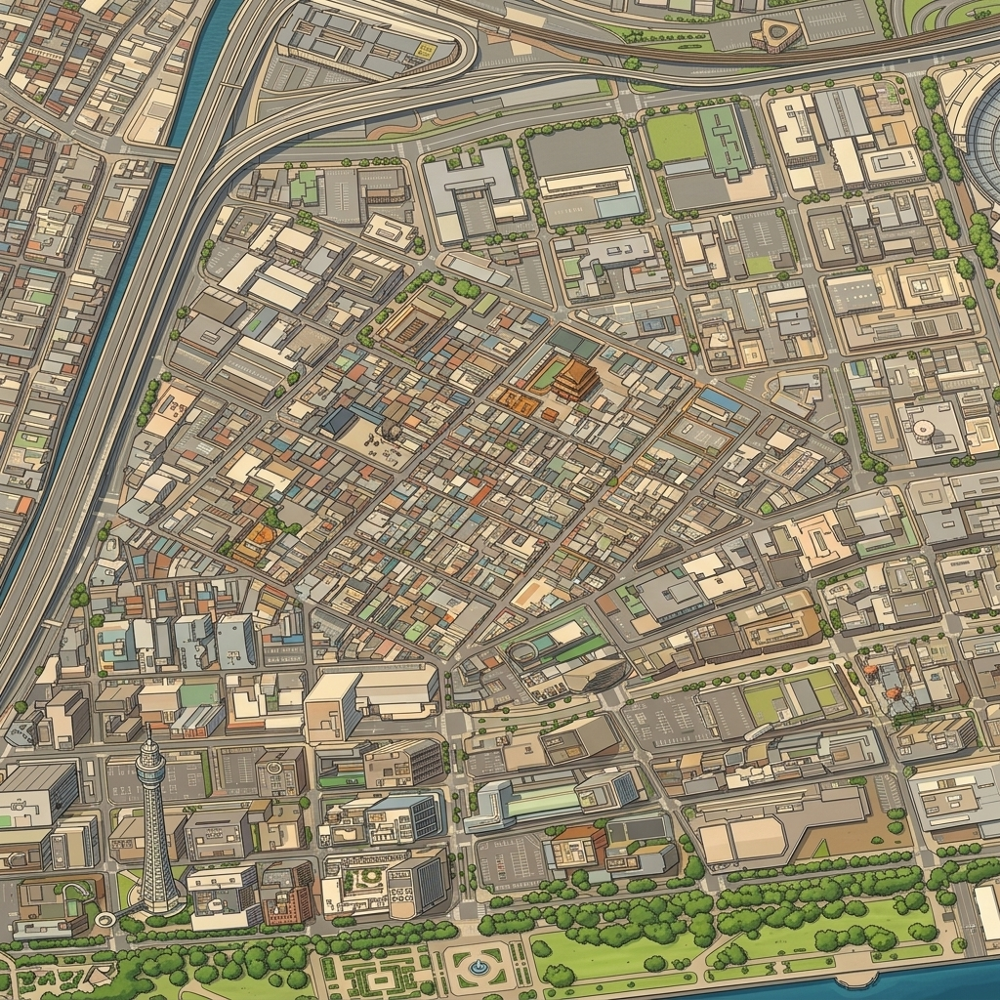
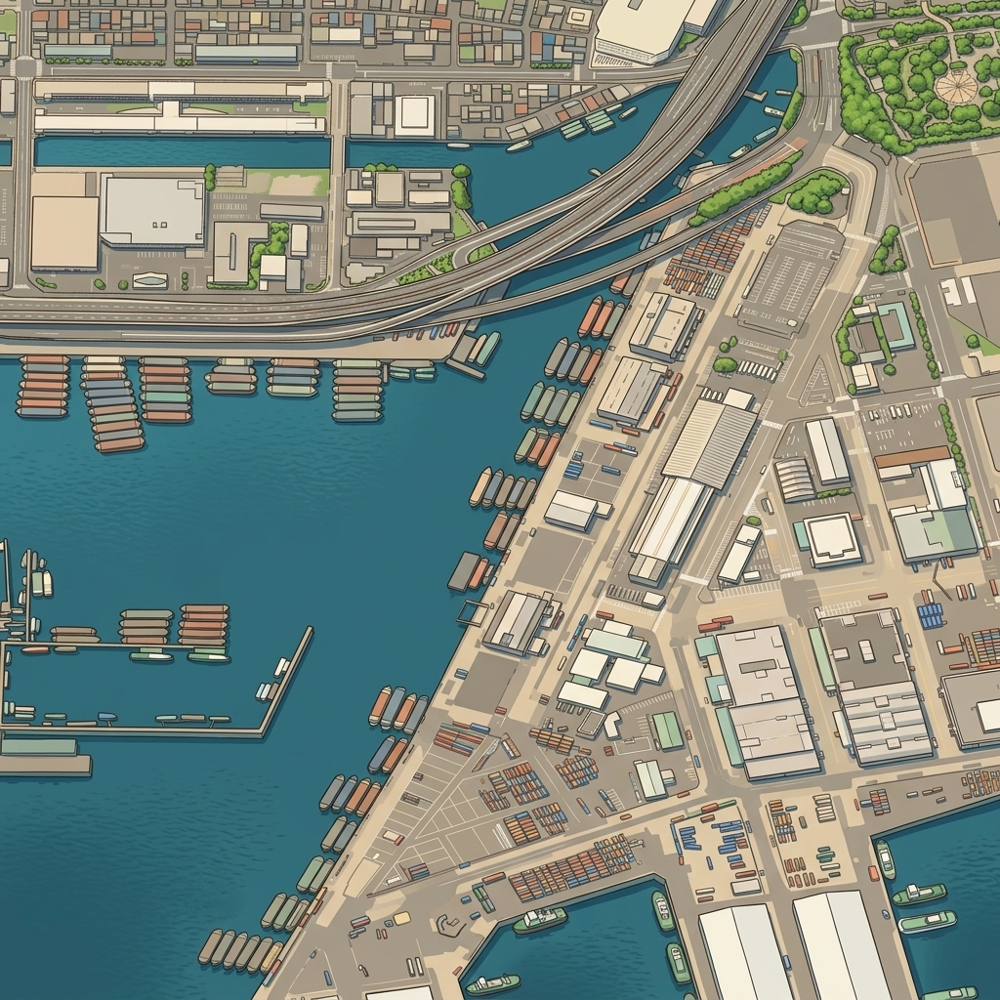
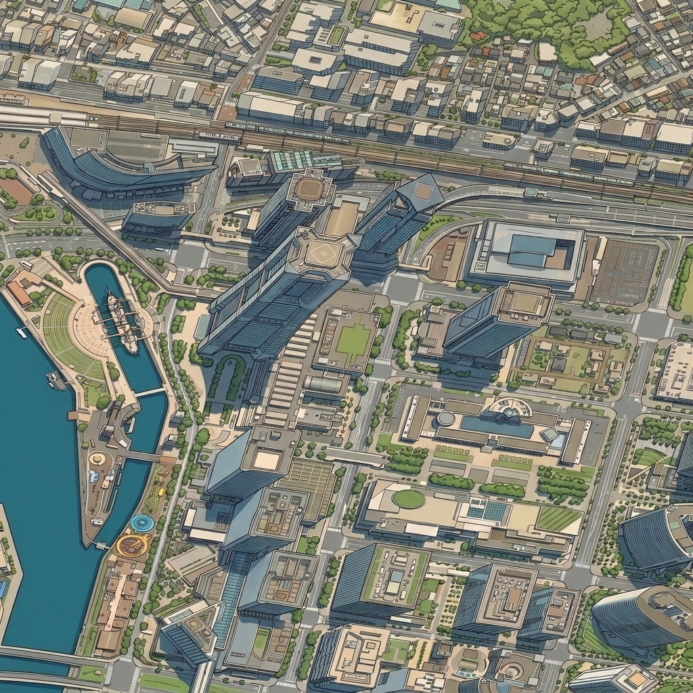
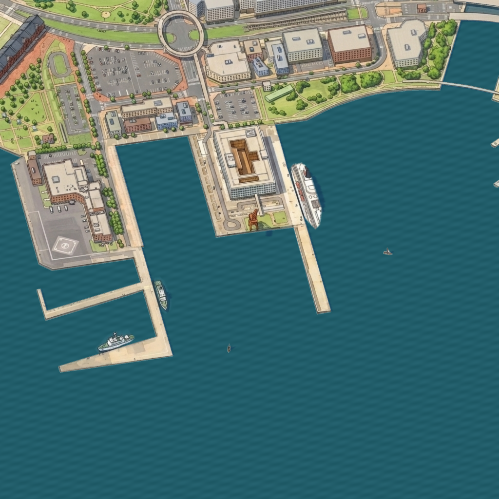

# Small Yokohama · スモール横浜

[日本語 (README.ja.md)](README.ja.md) · [全体タイル割当・座標表](docs/tile-grid-plan.md) · [Study area (GeoJSON)](scope/waterfront.geojson) · [System design](docs/design.md) · [Development stack](docs/technology.md) · [Research & sources](docs/research.md)

> **An interactive, zoomable miniature illustration of Yokohama's waterfront** — inspired by [Small SF](https://smallsf.com/).  
> 横浜駅からみなとみらい・新港・赤レンガ倉庫を経て山下公園・元町中華街までを、45°正射影の Ligne-Claire 手描きミニチュア地図と実測交通オーバーレイで再現するオープンプロジェクトです。現在 **新港パイロット 4 タイル ＋ 担当 1（`moruku36`）4 タイル ＋ 担当 2（`phase-a-2`）4 タイルの計 12/23 タイルが完成**（過半数達成）し、残り **11 タイル** を進めています。

---

## 現在の制作進捗（12 / 23 タイル完了・52%）

> 全 23 タイルが揃い次第、全体 1 枚への連結・DZI ピラミッドビルドおよび全体ビューア反映を実施予定です。

- [x] **先行パイロット** (`pilot`: 4/4 完了) — ハンマーヘッド・大さん橋・赤レンガ倉庫・ワールドポーターズ・汽車道・横浜スタジアム・日本大通り
- [x] **担当 1** (`phase-a-1`: 4/4 完了 / `moruku36`) — 山下公園・氷川丸・横浜マリンタワー・横浜中華街・山下ふ頭・港の見える丘公園・元町
- [x] **担当 2** (`phase-a-2`: 4/4 完了 / `moruku36`) — 横浜ランドマークタワー・クイーンズスクエア・パシフィコ横浜・臨港パーク・新高島・日産本社・中央卸売市場
- [ ] **担当 3** (`phase-a-3`: 0/4 未着手) — 横浜駅東西・そごう・横浜ベイクォーター・鶴屋町・ポートサイド北部
- [ ] **担当 4** (`phase-b-1`: 0/4 未着手) — 山手南・石川町駅・関内駅・野毛
- [ ] **担当 5** (`phase-b-2`: 0/3 未着手) — 紅葉坂・戸部駅・平沼橋方面

---

## 今作っているもの：現在の制作プレビュー（完了済み 12 タイル）

国土地理院 `z=18` 空中写真＋OpenStreetMap 3D 地物を 45° 正射影カメラで固定レンダリングし、1枚ずつ Ligne-Claire インク＋暖色系ガッシュ画風へ清書した成果物です。

### 先行パイロット 4/4（128px 重複帯シームレス結合済み：`3968 × 3968 px`）



### 担当 1（`phase-a-1`：元町・山手・中華街・山下公園・氷川丸・山下ふ頭 4/4 完了）

| 左上 `tile_-2_0`（港の見える丘公園・山手・元町） | 右上 `tile_-1_0`（山下公園・マリンタワー・中華街） |
| :---: | :---: |
|  |  |
| **左下 `tile_-2_1`（山下ふ頭南・新山下運河・はしけ泊地）** | **右下 `tile_-1_1`（山下公園海側・氷川丸・山下ふ頭北）** |
|  |  |

### 担当 2（`phase-a-2`：みなとみらい・ランドマーク・パシフィコ・新高島・卸売市場 4/4 完了）

| 左上 `tile_2_0`（ランドマーク・クイーンズ・日本丸） | 右上 `tile_3_0`（新高島・日産本社・メディアタワー） |
| :---: | :---: |
|  |  |
| **左下 `tile_2_1`（パシフィコ・インターコンチ・臨港パーク）** | **右下 `tile_3_1`（高島水際線・みなとみらい大橋・中央卸売市場）** |
|  |  |

### ズーム拡大・境界シーム確認

| マスター画風基準 (#1: `tile_1_1`) | 境界シーム確認（サークルウォーク〜ワールドポーターズ） |
| :---: | :---: |
|  |  |
| **横浜スタジアム（`tile_0_0` 拡大）** | **汽車道・運河（`tile_1_0` 拡大）** |
|  |  |

- **パイロット実測 QA 結果（`viewer/public/releases/pilot-shinko-v1/qa-report.json`）**:
  - 位置合わせ相関: 全 4 タイル **`shift=(0,0) px`**、Sobel エッジ相関 **`edgeCorr = 0.770 〜 0.858`**
  - 8 地点 GCP 最大誤差: **`0.601 px`**（許容 `<= 8 px`）
  - 境界シーム色差（14px DP 最小色差接続）: `6.32` / `9.83` / `23.07`（許容 `< 48`、**全境界合格**）
  - 水域捏造ゼロ確認: `waterInventedBuildings = 0` / `voidPixels = 0`

---

## 制作で気をつけているこだわり（品質方針）

[Small SF Author's making-of](https://smallsf.com/about) の設計思想を取り入れ、見た目の可愛らしさと地図・データとしての正確さを両立するため、以下を徹底しています。

1. **45° 正射影 × 奥行き（Depth）による自然な隠れ表現**  
   すべてのタイルを同一カメラ（`azimuth = 225°`, `depression = 45°`, `0.34 m/px`）で固定し、奥行き・路面標高マップを同時生成しています。これにより、動くバスや船がサークルウォーク・建物・橋の裏に差し掛かると車体の一部だけが自然に隠れます。
2. **国土地理院 `z=18` 空中写真＋OSM 3D による「完全ピクセル固定」**  
   想像で街並みを描かず、航空写真と 3D 地物を隙間なく投影した `_base.png` を下絵にロックします（1px の回転・拡大・トリミングも禁止）。
3. **画風ドリフトを防ぐ「マスター1枚固定ルール」**  
   隣り合うタイル同士を数珠つなぎで参照すると少しずつ色味や線幅がズレます。**全タイル必ず `data/drawn-tiles/tile_1_1.png`（#1）1 枚のみを画風リファレンスに固定** してください。
4. **水面と船舶・陸地の厳密な分離**  
   海面だけでなく運河・川（汽車道まわり・新港橋・大岡川・中村川等）もすべて **深いティールブルー（`#226276`）** に統一します。合成時は 3D 水域マスクと 22px 船舶保護ハローを使い、船が陸地に乗り上げたり海上に架空の建物が現れたりするのを防いでいます。
5. **128px オーバーラップ＋自動 QA ゲート**  
   タイル間は 128px 重ねて生成し、DP 最小色差カットで継ぎ目を消しています。納品時は必ず `render:tile` の Sobel 相関で **`|shift| <= 8 px`**・**`edgeCorr >= 0.70`** を確認します。

---

## 全体タイル数とチーム割り振り計画

[scope/waterfront.geojson](scope/waterfront.geojson) の横浜臨海部全体（横浜駅〜みなとみらい〜新港〜山下公園〜元町・中華街）をパイロット同一仕様（`2048 × 2048 px` / 歩進幅 `stride = 1920 px = 652.8 m` / 重複 `128 px`）で割ると、以下の通りになります。

- **全体格子サイズ**: **3 行 × 8 列 = 24 タイル**（`row = -1..1`, `col = -2..5` / 合成時 `15,488 × 5,888 px`）
- **スコープ対象タイル**: **全 23 タイル**（北西端の `(5, -1)` のみポリゴン範囲外）
- **完了済み**: **12 タイル**（先行パイロット #1〜#4 ＋ 担当 1 `phase-a-1` 4 枚 ＋ 担当 2 `phase-a-2` 4 枚）
- **残り制作タイル**: **11 タイル**（矩形 24 タイルで埋める場合は 12 タイル）
  - **フェーズ A（臨海・主要駅コア `row = 0..1`）**: 全 12 タイル中 **8 枚完了・残り 4 タイル**（担当 3 のみ残り 4 枚）
  - **フェーズ B（内陸縁辺ベルト `row = -1`）**: **残り 7 タイル**（担当 4・担当 5 の 3〜4 タイル）

```text
row \ col   -2    -1     0     1     2     3     4     5
   -1       B1    B2    B3    B4    B5    B6    B7     .    <-- フェーズB 残り7枚 (山手・石川町・関内・野毛・戸部・平沼橋)
    0      [A1]  [A2]  [P4]  [P3]  [A5]  [A7]   A9   A11    <-- フェーズA ([A1/A2/P3/P4/A5/A7 完了], A9/A11 残り)
    1      [A3]  [A4]  [P2]  [P1]  [A6]  [A8]  A10   A12    <-- フェーズA ([A3/A4/P1/P2/A6/A8 完了], A10/A12 残り)
```

| フェーズ | 担当 | ブロック名 (`--block`) | 割り当てタイル | 主なエリア |
| --- | --- | --- | --- | --- |
| 完了 | 先行パイロット | `pilot` | `(1,1), (0,1), (1,0), (0,0)`（**4/4 完了**） | ハンマーヘッド・大さん橋・赤レンガ・ワールドポーターズ・汽車道・横浜スタジアム・日本大通り |
| 完了（**A**） | **担当 1（moruku36）** | `phase-a-1` | `(-2,0), (-1,0), (-2,1), (-1,1)`（**4/4 完了**） | 山下公園・氷川丸・マリンタワー・中華街・山下ふ頭・元町 |
| 完了（**A**） | **担当 2（moruku36）** | `phase-a-2` | `(2,0), (2,1), (3,0), (3,1)`（**4/4 完了**） | ランドマークタワー・クイーンズスクエア・パシフィコ・臨港パーク・新高島・Kアリーナ |
| **A** | **担当 3** | `phase-a-3` | `(4,0), (4,1), (5,0), (5,1)`（4枚） | 横浜駅東西・そごう・ベイクォーター・鶴屋町・中央卸売市場 |
| **B** | **担当 4** | `phase-b-1` | `(-2,-1), (-1,-1), (0,-1), (1,-1)`（4枚） | 山手南・石川町駅・関内駅・野毛 |
| **B** | **担当 5** | `phase-b-2` | `(2,-1), (3,-1), (4,-1)`（3枚） | 紅葉坂・戸部駅・平沼橋方面 |

全 23 タイルの中心緯度経度・ランドマーク対応表は [docs/tile-grid-plan.md](docs/tile-grid-plan.md) に記載しています。

---

## チームメンバー向け：担当タイルの作り方（手順・モデル設定・プロンプト例）

### ステップ 1：環境セットアップと担当ブロック用ブランチ作成

```powershell
# 例: 担当3（横浜駅・ベイクォーター・ポートサイド）の場合
git checkout -b tile/phase-a-3-yokohama-station
npm.cmd install   # macOS/Linux は npm install
```

### ステップ 2：自分の担当タイルの下絵（`_base.png`）を自動生成する

どの列範囲（`col = -2..5, row = -1..1`）でも使える汎用ベースレンダラー `render:tile` を用意しています。担当ブロック名または任意の `<col>,<row>` を指定すると、国土地理院 `z=18` 空中写真の取得から `2048×2048 px` 正射影ベース画像の出力まで自動実行されます。

```powershell
# 担当ブロックを一括生成する例（Windows PowerShell）
npm.cmd run render:tile -- --block phase-a-3

# 1タイルだけ生成する例（macOS/Linux は npm run render:tile -- --tile 4,0）
npm.cmd run render:tile -- --tile 4,0
```

出力先: `data/tile-renders/tile_{col}_{row}_base.png`（例: `tile_4_0_base.png`）

### ステップ 3：推奨する AI エージェント / モデル設定

先行 4 タイルは、以下の組み合わせ・方針で制作することで高い位置精度と画風一貫性（全 4 タイル `shift=(0,0) px`、`edgeCorr = 0.770〜0.858`）を達成できました。

- **オーケストレーター／指示役には上位の推論モデルを選ぶ（重要）**:  
  先行 4 タイルは **`gemini-pro-orchestrator-neon` クラスのハイエンド上位モデル** で全体計画・手順管理・ベース生成・画像生成指示・Sobel 位置検証・目視チェックまでを一貫制御し、作画担当に **`image-generator` サブエージェント** を使って実現しました。軽量モデル任せにすると、角度が勝手に変わる・運河が航空写真の茶色のまま残る・周辺建物が簡略化されすぎる傾向があるため、**上位のオーケストレーター／推論モデルを選定する**のがおすすめです。
- **参照の渡し方（必須の 2 点セット）**:
  1. **参考思想**: [Small SF](https://smallsf.com/) / [Author's making-of](https://smallsf.com/about) に近い 45° ミニチュア建築イラスト調で作ること
  2. **2 枚の参照画像を同時指定**:
     - **画像 1（形状・位置 100% 固定ベース）**: `data/tile-renders/tile_{col}_{row}_base.png`
     - **画像 2（画風・配色専用マスター）**: `data/drawn-tiles/tile_1_1.png`（※毎回必ず `#1` を参照）

### ステップ 4：そのまま使えるプロンプト例（コピペ用）

#### 例 A：AI コーディングエージェント（Antigravity 等）に担当ブロック制作を頼む場合

```text
あなたは Small Yokohama のタイル制作担当です。
参考サイト https://smallsf.com/ と https://smallsf.com/about に近いミニチュア建築イラスト調で、
担当タイル `tile_{col}_{row}`（例: `tile_4_0` 横浜駅・そごう・スカイビル周辺）を作成してください。

手順：
1. まだなければ `npm.cmd run render:tile -- --tile {col},{row}`（macOS/Linuxは `npm`）を実行し、
   `data/tile-renders/tile_{col}_{row}_base.png` を生成して中身を目視確認してください。
2. `image-generator` サブエージェント（または画像生成モデル）へ以下の2画像を渡して作画してください：
   - 参照画像1（レイアウト・建物位置を1pxも変えない固定下絵）: `data/tile-renders/tile_{col}_{row}_base.png`
   - 参照画像2（画風・線幅・配色・水面色だけのマスター基準。※構図はコピーしない）: `data/drawn-tiles/tile_1_1.png`
3. 生成画像を `data/drawn-tiles/tile_{col}_{row}.png`（RGB PNG）として保存し、
   既存メタ（例: `data/drawn-tiles/tile_1_0_meta.json`）に倣って `data/drawn-tiles/tile_{col}_{row}_meta.json` を作成してください。
4. 再度 `npm.cmd run render:tile -- --tile {col},{row}` を実行して Sobel 相関チェックを行い、
   `|shiftDx|, |shiftDy| <= 8 px` かつ `edgeCorr >= 0.70` であること、および出力される
   `data/drawn-tiles/tile_{col}_{row}_overlay_check.png` に二重ズレや海上の架空建物・茶色い運河が残っていないことを目視で確認してください。
```

#### 例 B：画像生成モデル（`image-generator` 等）へ直接渡す指示プロンプト

```text
Create a 1024x1024 illustrated architectural map tile for Small Yokohama in the exact Small SF (smallsf.com)
Ligne-Claire ink + warm sunlit gouache miniature style, STRICTLY pixel-locked to Reference Image 1 (`tile_{col}_{row}_base.png`)
and styled identically to Reference Image 2 (`tile_1_1.png`).

CRITICAL RULES:
1. Reference Image 1 is the 100% PIXEL-LOCKED GEOMETRY & LAYOUT BASE:
   - Keep EVERY building, tower, bridge, street, crosswalk, park, railway track, and shoreline in its EXACT pixel position.
   - ZERO camera rotation, ZERO zoom, ZERO cropping, ZERO tilt change, ZERO borders/margins/frames.
   - Edge-to-edge 1:1 square image. NO text, NO map labels, NO numbers, NO watermarks anywhere.
2. Reference Image 2 (`tile_1_1.png`) is the LOCKED MASTER STYLE REFERENCE ONLY (do NOT copy its layout):
   - Match Image 2's exact crisp dark charcoal-brown Ligne-Claire ink linework (`#2a2420`) on roof edges, facade grids, bridges & seawalls.
   - Match Image 2's warm late-afternoon gouache palette, fluffy sunlit green trees, and crisp soft slate-blue WNW shadows toward lower-left.
3. WATER & AERIAL DETAILS:
   - Paint ALL water surfaces (bay, canals, rivers, docks) cleanly in Image 2's `#226276` deep oceanic teal-blue with subtle fine wave ripples
     (never leave brownish-olive aerial canal water!).
   - Convert EVERY building footprint visible in Image 1's aerial photography cleanly into sharp miniature 3D Ligne-Claire buildings
     with detailed window mullions and rooftop HVAC units at matching 45-degree isometric scale.
```

### ステップ 5：セルフ検証して Pull Request を出す

1. 作成したタイルを `data/drawn-tiles/tile_{col}_{row}.png` と `data/drawn-tiles/tile_{col}_{row}_meta.json` に保存（※`_composited.png`・`_overlay_check.png`・`data/gsi-aerial/`・`data/tile-renders/` は `.gitignore` 済みなのでコミットされません）。
2. 以下を実行して全チェック通過を確認：
   ```powershell
   npm.cmd run render:tile -- --tile <col>,<row>
   npm.cmd run typecheck
   npm.cmd run test
   npm.cmd run build
   ```
3. コンフリクト防止のため、**1 担当ブロック（または 1 タイル）= 1 ブランチ / 1 PR** で GitHub へ提出してください。

---

## ローカルビューア起動・既存パイロット全体ビルド

```powershell
# 全4タイル先行パイロット（DZI生成・深度・QA）の再ビルド
npm.cmd run build:pilot

# 開発サーバー起動（http://127.0.0.1:5173）
npm.cmd run dev
```

---

## Credits & License

- **Inspiration**: [Small SF](https://smallsf.com/) · [Author's making-of](https://smallsf.com/about) by Ari Dutilh
- **Geographic & Aerial Sources**: [OpenStreetMap (ODbL)](https://www.openstreetmap.org/copyright) · [国土地理院（地理院タイル：シームレス空中写真 z=18）](https://maps.gsi.go.jp/development/ichiran.html) · [Project PLATEAU Yokohama FY2024](https://www.geospatial.jp/ckan/dataset/plateau-14100-yokohama-shi-2024)
- **Repository Code & Docs**: [MIT License](LICENSE) · [Source and credit register](docs/research.md)
