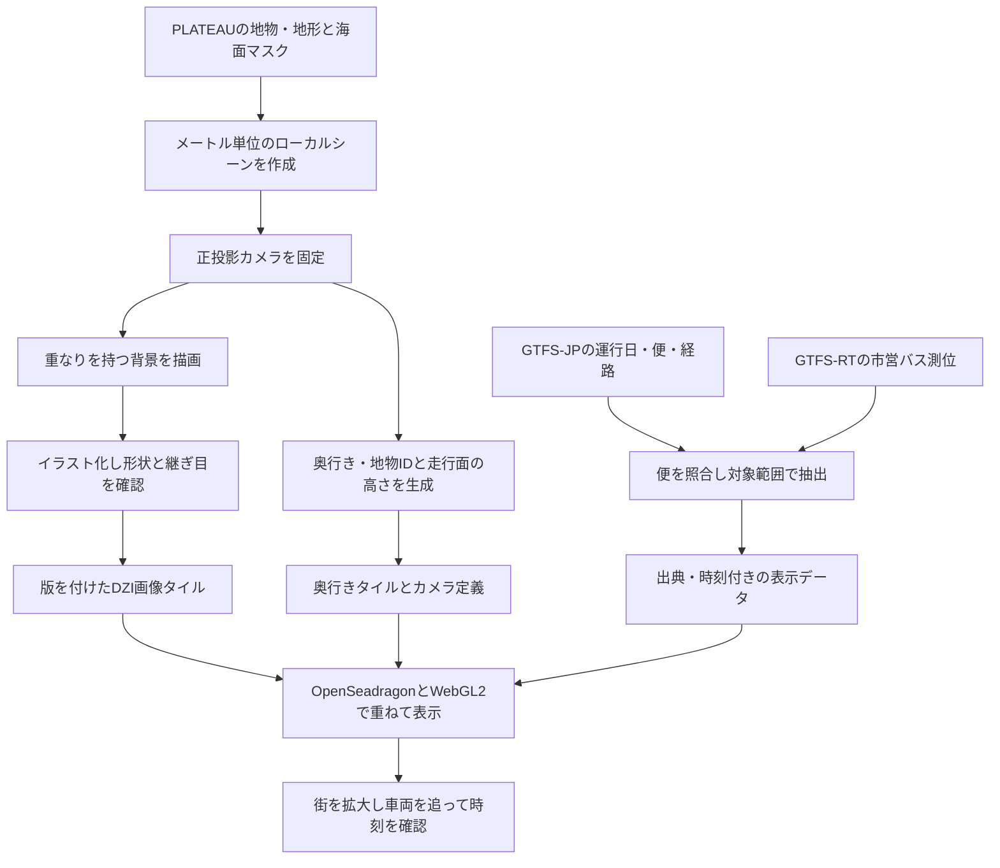

# 横浜の海側を、小さな動く街にする設計

[English](design.md) · [ホーム](../README.ja.md) · [範囲の地図](../scope/waterfront.geojson) · [出典一覧](research.ja.md)

## どこを描くか

北は横浜駅東口、中央はみなとみらい・桜木町と新港、南東は大さん橋、山下公園を経て元町・中華街駅まで。初期画面はみなとみらいです。海側には船を描ける余白を取り、内陸側はこの回廊で切ります。[GeoJSON](../scope/waterfront.geojson)では、海面を含む外周、先行街区、目印の概略位置をWGS84の経度・緯度で確認できます。描画範囲と費用見積もりに使う編集用の線で、測量の基準点には使いません。

先行街区は赤レンガ倉庫と新港サークルウォーク周辺です。数枚の絵で、倉庫の屋根がタイルの境界をまたぐ場所、岸壁と海面の境、歩道橋の下を車両が通る場所を試せます。道路の位置と橋の収録状況は対象メッシュで確認します。デッキが未収録なら、独自に補った簡略形状をシーンの記録に明示します。

## 背景と乗り物は一つのカメラで合わせる

### 背景は事前に作る

1. **地物を切り出す。** 2024年度のCityGMLから建物・地形・橋梁を取得します。高層ビルの映り込みと画像の重なりを見込み、外周に余白を設けます。PythonとPROJ/pyprojで座標を変換し、Blenderで読めるローカルメッシュにします。元の地物IDと版を保ち、街区ごとに利用可能な詳細度を記録します。
2. **同じ変換を共有する。** バスの緯度経度と街の座標をJGD2011の平面直角座標系第IX系（EPSG:6677）へ変換し、軸順を東・北に正規化して共通原点を引きます。高さの基準、地面と高架を区別します。カメラは港側から南西を望む俯角45度を初期案とし、ビュー・投影行列、画像原点、1画素の長さ、奥行き範囲、タイル格子を保存。描画とクリック判定は両方とも「実座標 → 原画上の画素 → 画面」を通します。
3. **原画を作って絵にする。** Blenderのヘッドレス描画で、まず2×2枚、作業画像2,048 px、重なり128 pxを試します。通常の色画像、カメラからの奥行き、地物ID、海面マスクを出力。走行面の高さは道路・デッキ別に保存します。再現可能な単色調レンダーを基準に、独自の見本を与えた画像モデル版を同じ4枚で比較します。モデル版、指示、ハッシュ、生成回数、採用1枚あたりの費用を記録し、失敗した箇所だけ作り直します。
4. **つないで配信する。** 岸壁やランドマークの輪郭を保ち、海だけの区画は一定の塗り方で埋めます。隣の絵との差が小さい線を継ぎ目に選び、地形と合うかを確認。libvipsで配信用の256 px DZIタイルを生成します。奥行きと地物IDは物体の境界を混ぜず同じ格子に変換。背景・カメラ・補助データを一つの版としてストレージとCDNへ置き、公開版を指す小さなファイルをまとめて切り替えます。前版にも戻せます。

### バスを動かす

TypeScriptとOpenSeadragonで背景を表示し、WebGL2の描画面を一枚重ねます。移動、拡大縮小、画面サイズ・画素密度の変更時に車両の位置を再計算します。車体と街の奥行きを同じ基準で画素ごとに比較すると、バスが倉庫の角を曲がるとき先頭から順に隠れます。車両には実際に走る道路の高さを使います。頭上の歩道橋を地面として読むとバスが橋の上に飛び乗ってしまいます。

ODPTのトークンはサーバーの取得処理だけに置きます。日本時間の運行日、日付をまたぐ時刻、例外運行日を考慮し、静的データと動的位置の事業者・便・方向を照合。取得間隔は提供条件の範囲で30秒を初期案とします。経路への位置補正は許容距離を実測してから使い、便が結び付かない位置はその路線に表示しません。許された範囲で画面用の短寿命データを利用者間で共有し、非表示タブのアニメーションを止めます。

| 画面の状態 | 動作案 |
| --- | --- |
| 実測 | 車両自身の観測時刻を表示。90秒以内の有効な観測間だけ、対応する経路に沿って補間。最新の実測より先を予測する場合は推定と明記する。 |
| 古い・取得不能 | 90秒を超えた実測は停止し経過時間を表示。5分を超えたマーカーは消す。観測時刻が欠けたデータは新鮮と扱わない。運行なし、便との照合失敗、配信障害を区別する。 |
| 予定 | 明示的に切り替えられる時刻表レイヤーを用意。経路と通過時刻が足りる区間だけ位置を推定。客船なら岸壁と予定時刻のカードで表現できる。 |
| 演出・再生 | 合成の試験バス、左側通行の一般車、記録再生には常に区分を表示。認証やデータ再配布に制約がある場合も、合成データでビューア全体を試せる。 |

画面用データには匿名の車両ID、出典、区分、観測時刻と取得時刻、許可されている範囲の便・路線IDと緯度経度、配信状態を含めます。通信トークンや上流の生レスポンスは配りません。古い観測をキャッシュから読み直しても観測時刻は更新しません。

### 画面でできること

みなとみらいからドラッグ・ピンチで探索し、日英の名所やバスを選択します。カードには路線、方向、何秒前の観測か、出典を表示。キーボードによる移動・拡大、地図を使わず選べる名所一覧、動きを抑える設定、レイヤー切り替え、クレジットを設けます。共有URLは範囲内の視点とレイヤーを保存。初期の港は昼夜と入港予定、将来の追加候補は利用許諾を確認したAIS、気象、地下鉄の断面表示、一般車、航空機です。

## 実装順と合格条件

以下は試作の目標値です。今回の設計段階で有償の画像生成、認証付き実配信の照合、端末性能の計測は行っていません。

| 段階 | 作るもの | 次に進む判定 |
| --- | --- | --- |
| 1　新港の静止画 | 背景4枚、カメラ定義、通常版とイラスト版 | 原画上で別途選んだ地上の目印6点以上を照合し、試作の原寸でずれ8 px以内を目標にする。すべての継ぎ目と岸壁を確認。海上に架空の建物が出た絵は作り直す。 |
| 2　動く1台 | 時刻と走行階層が分かる合成の軌跡 | サークルウォークの手前・真下・通過後で「見える→隠れる→見える」を確認し、デッキ上の点も別に試す。拡大・画面サイズ変更後も背景とのずれは2 CSS px以内。 |
| 3　実測1路線 | 平日の営業中、往復の出発を含む時間帯でベイサイドブルーを照合 | 受信件数、便との照合率、未照合の理由、観測の古さの95パーセンタイルを記録。往復で各1件以上の新鮮な実測が取れ、古い観測・時刻欠損・配信停止の試験も通れば実測レイヤーを公開。それまでは表示区分の付いた予定または合成を使う。 |
| 4　海沿い全域 | 南北に隣接街区を追加。名所、入港予定、共有に対応 | 機種を記録した中価格帯スマートフォンと固定の通信条件で、初期操作可能まで4秒以内、30秒の地図移動中はフレーム時間の95パーセンタイル33 ms以内を目標にする。配信停止時も再試験。超過時は画面外の車両を除外し、詳細度や演出車の密度を下げる。 |

**費用の見積もり方。** 最初の4枚で描画時間、採用1枚あたりの生成回数、1回単価、背景と奥行きの容量、初回表示の取得数を測ります。「着色が必要な陸・岸壁の枚数 × 採用までの試行回数 × 単価」に、描画・保管・配信・バス取得処理の費用を加えます。海だけの区画は自動で塗ります。全域を生成する前に試作の実測から予算を決めます。画像モデルで位置や費用を維持できなければ、既に比較用に作った通常レンダーを採用できます。
