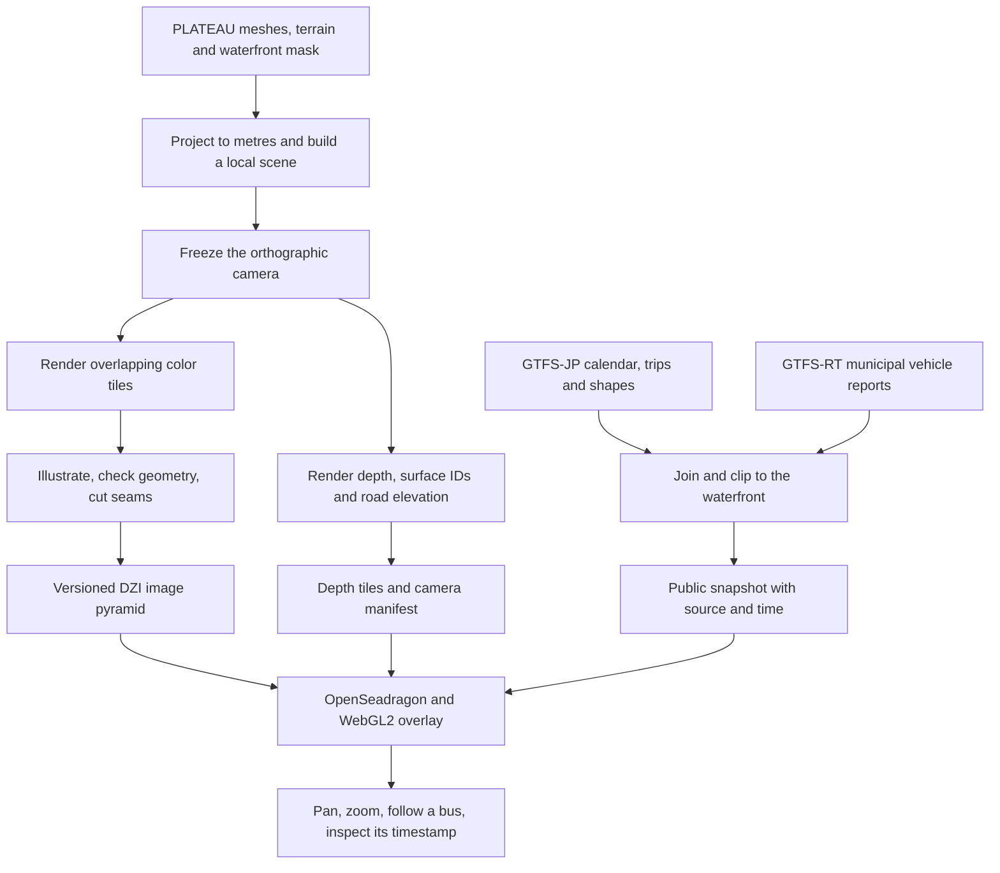

# Designing the waterfront miniature

[日本語](design.ja.md) · [Home](../README.md) · [Development stack and data](technology.md) · [Mapped boundaries](../scope/waterfront.geojson) · [Source register](research.md)

## Where to draw

Frame the east side of Yokohama Station, Minato Mirai and Sakuragicho, the Shinko piers, Osanbashi and Yamashita Park, ending at Motomachi-Chukagai Station. Minato Mirai is the opening view. Leave room on the harbor side for ships and crop the inland neighborhoods. The [GeoJSON](../scope/waterfront.geojson) contains an editorial land-and-water polygon, a smaller pilot rectangle and approximate landmarks in WGS84 longitude/latitude. It sets the art budget and camera bounds; the points are unsuitable as surveyed control points.

The pilot is the Red Brick Warehouse and Shinko Circle Walk. In one small area we can test brick roofs crossing a tile boundary, land meeting open water, and a vehicle moving below an elevated walkway. Confirm the covered bus road and bridge geometry from the selected source meshes. If the deck is absent, build a documented original proxy and label it in the scene manifest.

## Two pipelines meet at the camera

### Produce the map once

1. **Geometry.** Clip the FY2024 CityGML to the study polygon plus a margin for tall buildings and tile overlap. Use Python and PROJ/pyproj for coordinates; convert the selected building, terrain and bridge surfaces into local meshes for Blender. Keep source feature IDs. Pin input resources and preserve the best available level of detail for each block.
2. **One transform.** Normalize axis order explicitly. Convert WGS84 feed points and source geometry to the same metric frame (JGD2011 / Japan Plane Rectangular CS IX, EPSG:6677, projected easting/northing). Subtract one origin. Resolve vertical datum, ground and elevated decks before assigning height. Fix an offshore camera looking southwest at a proposed 45-degree depression. Save its view/projection matrices, image origin, metres per pixel, near/far planes and tile grid. Map a point through world → full-image pixel → viewport for every draw and hit test.
3. **Render and illustrate.** Run Blender headless with an orthographic camera. Start with a 2 × 2 patch, 2,048 px working tiles and 128 px overlap as pilot parameters. Render neutral color, camera-depth in metres, feature IDs and a water mask. Keep a separate drivable-surface height keyed by road/deck. Start with a reproducible flat-color render, then compare an optional image-model pass on the same tiles using original style references. Log model/revision, prompt, hashes, attempts and accepted cost. Redraw only failed tiles.
4. **Join and publish.** Protect waterfront and landmark outlines, fill all-water tiles deterministically, and cut through the lowest color disagreement in overlaps. Compare geometry before accepting a drawing. Use libvips to generate 256 px DZI delivery tiles. Resample the depth and ID layers on the same grid with edge-preserving sampling. Version the illustration, camera and auxiliary maps together. Publish immutable files on object storage/CDN; switch a small release manifest atomically and retain the previous version for rollback.

### Animate the city

Use TypeScript, OpenSeadragon for the image and one synchronized WebGL2 overlay for moving sprites. Reproject visible objects on pan, zoom, resize and device-pixel-ratio changes. At each sprite fragment compare vehicle depth and scene depth in the same camera convention. A bus should move behind a warehouse progressively. Sample the height of its assigned road or deck, so a pedestrian bridge above the street cannot lift it onto the bridge.

A small server-side collector owns the ODPT token. Resolve trips against the static feed for the operator and service day in Asia/Tokyo, including after-midnight times and calendar exceptions. Start with a 30-second polling target subject to provider limits. Join IDs and direction first; use shape snapping only within a tested tolerance. Keep an unmatched report out of the animated route. Share one normalized, short-lived snapshot across clients and validate display/cache permissions before publishing it. Render direction and route as well as position. Stop animation when the page is hidden.

| What the visitor sees | Proposed behavior |
| --- | --- |
| Observed | Show the vehicle's own observation time. Within 90 seconds, interpolate between valid observations along the matched shape. Do not run past the latest observation without a separate estimate label. |
| Stale or unavailable | At age over 90 seconds, freeze and show age. Over 5 minutes, remove the measured marker. A missing observation time cannot qualify as fresh. Distinguish no service, no match and feed outage. |
| Scheduled | Offer an explicitly labeled timetable layer. Move along a shape only with adequate stop times and route geometry. A port call can be a berth/time card. |
| Simulated or replay | Keep synthetic buses, left-hand road traffic and recorded sessions visibly labeled. A fixture can exercise the entire viewer if credentials or redistribution rights are unavailable. |

The public snapshot carries an opaque entity ID, source, mode, source timestamp, fetched timestamp, trip/route key if allowed, WGS84 location if present, and feed health. Do not expose the provider token or publish raw responses by default. A delayed observation keeps its original timestamp when a cache refreshes.

### What the visitor can do

Open on Minato Mirai, drag/pinch to explore and select a bilingual landmark or bus. The detail card shows route, direction, observation age and source. Offer keyboard zoom/pan, a landmark list independent of the canvas, reduced motion, layer switches and persistent credits. A share link stores a bounded camera position and layer choices. Initially the harbor offers daylight and scheduled port calls. Licensed AIS, weather, underground train views, general traffic and aircraft are later, independently switchable layers.

## Delivery and acceptance

All thresholds below are proposed test targets. No rendering benchmark, paid image generation or authenticated live-data trial has been run in this design release.

| Step | Deliverable | Check before expanding |
| --- | --- | --- |
| 1 · Shinko still image | Four tiles, camera manifest, plain and illustrated variants | Check at least six independent ground landmarks against the source render at full pilot scale; target ≤8 px displacement. Inspect every shared edge and the shoreline. Reject invented structures in water. |
| 2 · One moving bus | Synthetic trace with timestamps and an explicit road level | On approaching, passing below and leaving Circle Walk, check visible → occluded → visible. Check a point on the deck separately. Zoom/resize must keep control markers within 2 CSS px of their image anchors. |
| 3 · One measured route | Observe Bayside Blue in a weekday service window covering departures in both directions, using the current static feed | Report sample count, match rate, unmatched reasons and p95 observation age. Require a fresh matched observation in each direction to promote the observed layer. Inject stale, missing-time and outage fixtures and check the transitions. Otherwise ship the scheduled or synthetic layer with its label. |
| 4 · Waterfront release | Extend contiguously north and south; add landmarks, port schedule and sharing | On a named midrange phone over a recorded network profile target first usable view ≤4 s and p95 frame time ≤33 ms during a 30 s pan. Repeat with a feed outage. Cull offscreen sprites, lower detail or thin simulated traffic if over budget. |

**Cost experiment.** Measure render minutes, illustration attempts per accepted tile, price per attempt, tile bytes, depth bytes and cold-view requests on the four-tile patch. Estimate remaining cost from land/mixed tiles × attempts × price, plus rendering, storage, egress and collector runtime. Open-water cells use the procedural path. Agree a spend cap after the pilot, before commissioning the corridor. A conventional illustrated render remains a usable outcome if the image model moves landmarks or exceeds the cap.
